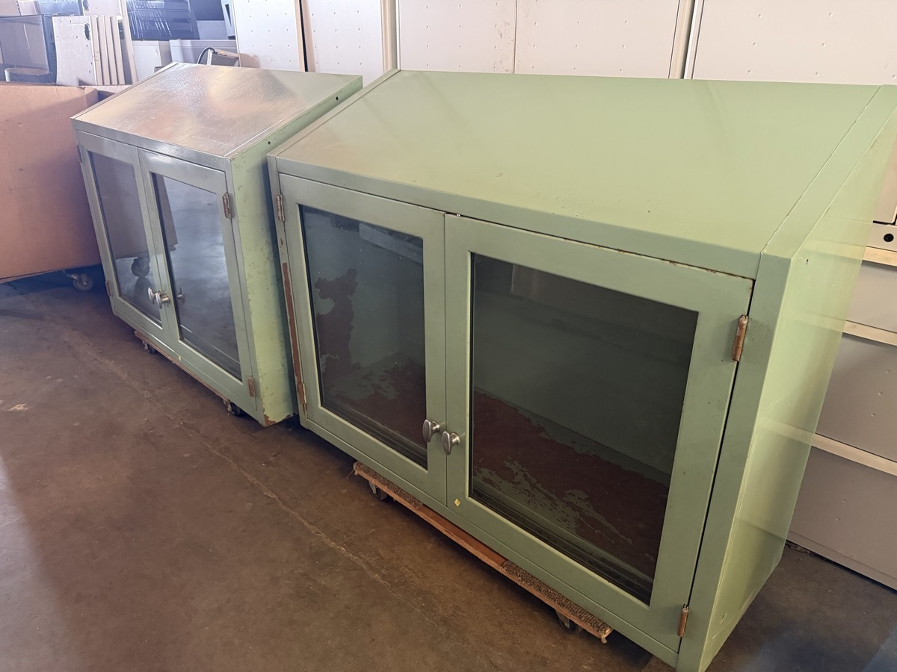

# Berkeley Outlet

Berkeley Outlet is a used office furniture and surplus warehouse associated with **711 Heinz Avenue, Berkeley, California**. The project materials document a mix of office furnishings, storage, shop equipment, appliances and unusual secondhand finds.

This is an independent, customer-made guide. It is not an official store account or a live inventory system. **The photos are an August 2026 snapshot. Current opening status and item availability are unconfirmed.** Check with the business before making a trip or arranging pickup.

## What you might find

The inventory notes describe these kinds of items:

- Office furniture: desks, rolling chairs, filing cabinets, conference tables and folding tables.
- Storage: metal cabinets, lockers, flat files, wire shelving, utility carts and stacking crates.
- Shop equipment: sewing machines, saws, drill presses, vises, compressors and hand trucks.
- Materials and supplies: lumber, pallet-racking components, hardware and caster wheels.
- Electronics and appliances: monitors, printers, cabling, ranges, microwaves and vending equipment.
- Odds and ends: letterpress supplies, CDs, lamps and other secondhand objects.

These are documented categories, not confirmed stock. Items may have sold or been removed. Exact models, dimensions, condition, quantities and prices need to be checked individually.

## A look inside

Browse the [photo gallery](GALLERY.md) for tables, cabinets, a sewing machine, a range, vending equipment and caster wheels. [inventory.json](inventory.json) contains the same photographed examples in a structured format, with availability explicitly marked unconfirmed.

## Location

The documented store address is 711 Heinz Avenue, Berkeley, CA 94710, near the west end of Heinz Avenue by the railroad tracks. [Find the address on a map](https://www.google.com/maps/search/?api=1&query=711+Heinz+Avenue+Berkeley+CA+94710).

Confirm current opening status, hours, prices, payment options and pickup arrangements directly with the business. No store hours or closing date have been verified for this guide.

## About this guide

Prepared October 30, 2026 from project notes and selected photographs. See [sources and limits](SOURCES.md) for provenance, photo dates and rights information, and [contribution guidance](CONTRIBUTING.md) for updates.
